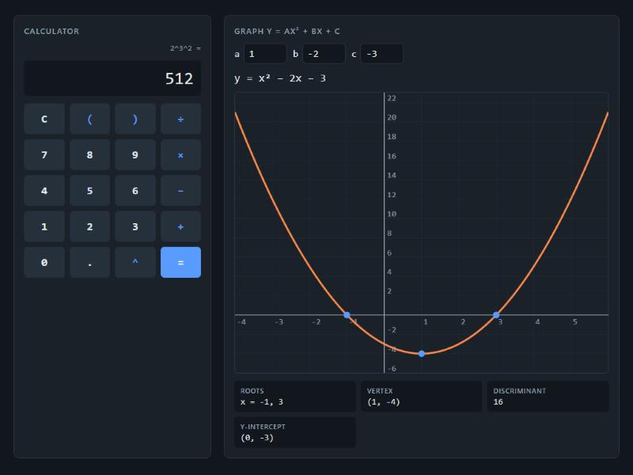

# Quadratic Calculator

A keypad calculator next to a live grapher for y = ax² + bx + c, packaged as a Windows desktop app with Electron.



Change a, b or c and the curve, roots, vertex, discriminant and y-intercept update as you type. The view stays
centred on the vertex and picks sensible grid steps (1, 2 or 5 × a power of ten) at any zoom. Complex roots are
shown as `re ± im i`. When a is 0 it switches to linear mode rather than dividing by zero. It follows the system
light/dark theme.

## Some details I cared about

- **No `eval`.** The keypad expressions go through a small recursive descent parser (`src/calc.js`), so the only
  thing that can run is arithmetic. It follows the normal rules: `2^3^2` is `2^9 = 512`, and `-2^2` is `-4`, like
  on paper.
- **Numerically stable roots.** The textbook formula loses the small root completely when b² is much larger
  than 4ac (try a=1, b=10⁸, c=1). `src/quadratic.js` uses the alternative form for the second root, and there's a
  test for that case.
- **Float noise is hidden**, so `0.1 + 0.2` shows `0.3`.
- **The maths is separate from the drawing**, so it can be tested in Node without a browser.
- **Offline**: no CDN fonts or scripts.

## Run it

```
npm install
npm start          # opens the Electron window
npm run dist       # builds a Windows installer into dist/
```

Or just open `src/index.html` in a browser.

## Tests

```
npm test
```
